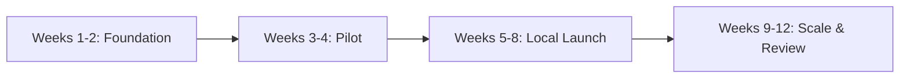

# Plan — Go-to-Market: Pricing, Domain, Brand & Marketing Strategy

Source: `plans/prompt.md`. Plan only; nothing is built yet.  
Date: 14 October 2026

---

## Goal

Take Service+ from two internal production deployments to a revenue-generating SaaS product for electronic gadgets repair workshops across India.

This plan covers:
1. Pricing evaluation and recommendation
2. Domain selection from available `.in` names
3. Brand decision: keep "Service+" or rename
4. Complete marketing plan with a 90-day launch timeline
5. Success probability assessment
6. Code changes (if any)

---

## Present Context

### Product

Service+ is a repair workshop management SaaS covering:
- Job sheets with full lifecycle tracking (intake → estimate → repair → delivery)
- Technician assignment and workload
- Spare-parts inventory with anti-pilferage controls
- GST and non-GST invoicing
- WhatsApp customer updates (shared central number)
- Extended-warranty lead management
- Role-based access control (Super Admin, Admin, Manager, business users)
- Ask AI help (Gemini free tier, 30 questions/day/BU)
- Reports and dashboard
- Multi-BU / multi-branch support (Enterprise)

**Status:** Running in **two internal production deployments**, tested and stable.

### Current Pricing (from server `.env` and portal fallback)

| Plan | Monthly | Setup | Users | Jobs/month | WhatsApp/month | Branches | BUs |
|------|---------|-------|-------|------------|----------------|----------|-----|
| Lite | Free | ₹0 | 1 | 75 | 20 | 1 (HO) | 1 |
| Basic | ₹2,999 | ₹2,000 | 1 | 150 | 150 | 1 (HO) | 1 |
| Standard | ₹5,999 | ₹2,000 | Multi | 400 | 300 | 1 (HO) | 1 |
| Enterprise | ₹10,999 | ₹5,000 | Multi | Unlimited | 2,000 | Multi | 5 (+₹3,000/extra) |

### Payment Model

Manual bank transfer → admin records payment. Server enforces `fee × months` minimum. No annual discount mechanism exists today. Unpaid months trigger view-only mode (except Lite, which is never billed).

### Enforcement Gaps (from `plan-workflow.md`)

- **Enforced:** branch limit (1 for Lite/Basic/Standard)
- **NOT enforced:** job/month limit, WhatsApp/month limit, single-user limit for Lite/Basic
- These limits exist on the portal pricing page but the server does not check them yet

### Competitor Landscape (checked 13 Oct 2026)

| Competitor | Type | Price Range |
|-----------|------|-------------|
| myBillBook | GST billing | ₹217–₹250/month |
| Vyapar | GST billing | ₹280–₹330/month (annual) |
| Techduple | Mobile repair billing | ₹799/month |
| RepairTrack | Repair + WhatsApp | Unlisted (Indian) |
| INOMS | Repair management | ~₹399/month |
| MyRepairShop | Repair management | ₹499–₹999/month |
| Kiwikit | Service centre | ₹500–₹1,250/quarter |
| StoreAxis Pro | Repair management | from ₹599/month |
| RepairDesk | Repair (US/global) | $99–$149/month (~₹8,000–₹12,500) |

**Key insight:** Indian repair-specific tools sit at ₹399–₹999/month. Generic billing apps are ₹200–₹350/month. Current Service+ Basic at ₹2,999 is **3–7× the local alternatives**.

---

## Step 1 — Price Evaluation & Recommendation

### Why the current prices are too high

1. **The buyer is a small independent repair shop owner** earning ₹30,000–₹80,000/month. ₹2,999/month is 4–10% of their income — a hard ask when MyRepairShop offers ₹499/month.
2. **₹2,000 setup fee creates a barrier.** A shop owner comparing free billing apps will not pay ₹2,000 upfront without trying the product first.
3. **Lite at 75 jobs is arguably enough for a one-person shop.** Many small shops handle 50–80 jobs/month — Lite may never push them to pay.

### What justifies a premium over billing apps

Service+ offers **significantly more** than billing-only tools:
- Full job lifecycle tracking with technician assignment
- WhatsApp customer updates (automated)
- Spare-parts inventory with pilferage control
- Extended warranty lead management
- Multi-user roles
- Ask AI help

This earns a **premium of 1.5–2× over basic billing apps**, but not 5–10×.

### Our costs per customer

| Cost Item | Amount |
|----------|--------|
| WhatsApp (utility, ₹0.12–₹0.15 per message × 150/month) | ~₹20–₹22/month |
| Hosting (shared CloudJiffy) | Negligible per customer |
| Ask AI (Gemini free tier) | ₹0 |
| **Real cost: your onboarding & support time** | Variable |

### Recommended Launch Pricing

| Plan | Monthly | Setup | Key Change |
|------|---------|-------|------------|
| **Lite** | Free | ₹0 | Keep as-is. Consider reducing to 50 jobs to create upgrade pressure |
| **Basic** | **₹799** | **₹0** (launch) | From ₹2,999. Matches top of Indian repair tool range |
| **Standard** | **₹1,499** | **₹0** (launch) | From ₹5,999. Multi-user is the upgrade driver |
| **Enterprise** | **₹3,999** | ₹4,999 | From ₹10,999. Dedicated database justifies setup fee |
| Extra BU (Enterprise) | **₹799/month** | — | From ₹3,000 |

### Annual Deal

Pay 10 months, get 12 (16.7% discount):
- Basic: ₹7,990/year (₹666/month effective)
- Standard: ₹14,990/year (₹1,249/month effective)
- Enterprise: ₹39,990/year

### Launch Offer

**First 50 paying workshops** keep the launch price permanently (as long as they remain subscribed). This creates urgency and rewards early adopters.

### Alternative (conservative) pricing

If you prefer not to drop as far:
- Basic: ₹1,499/month, Standard: ₹2,999/month, Enterprise: ₹6,999/month
- Setup waived for all during launch
- **Risk:** Most shops stay on Lite at these prices. The ₹1,499 Basic still competes with ₹999 MyRepairShop.

### GST note

Display prices as **"₹799/month + GST"** or **"₹799/month (excl. GST)"** if Kush Infotech is GST-registered. Confirm with your accountant. Avoid surprising customers at the first invoice.

### Server/code changes required for pricing

- Update `.env` values (your part — no code change)
- Update portal fallback in `service-plus-portal/content/pricing.ts`
- Update server defaults in `service-plus-server/app/core/plan_prices.py`
- Update `.env.example` in both portal and server
- For annual billing: the server's payment validation (`fee × months` check) needs a "free months per year" setting so paying for 10 months covers 12. This is a small code change in `app/graphql/resolvers/bu_admin/billing.py`.

---

## Step 2 — Domain Selection

### Available domains (from `notes/Marketting.md`)

**Recommended:** `myserviceplus.in` (₹549/year)

| Criterion | myserviceplus.in | repairplus.in | serviceforge.in |
|-----------|-----------------|---------------|-----------------|
| Brand continuity | ✅ Keeps "Service+" | ❌ Different name | ❌ Different name |
| Natural reading | ✅ "My service plus" | ✅ "Repair plus" | ⚠️ Technical |
| Already in code | ✅ Placeholder in `PORTAL_URL_PRODUCTION` | ❌ | ❌ |
| Repair-specific | ⚠️ Generic "service" | ✅ Says "repair" | ❌ |
| ₹/year | 549 | 549 | 549 |

**Decision: Buy both `myserviceplus.in` AND `repairplus.in`**

- **`myserviceplus.in`** → primary portal domain
- **`app.myserviceplus.in`** → CNAME to CloudJiffy env for the app
- **`repairplus.in`** → redirect to `myserviceplus.in` (defensive purchase + fallback brand)
- Keep `serviceplus.cloudjiffy.net` alive — WhatsApp template buttons point there

### Domains to avoid

- `repairtrack` — competitor RepairTrack already uses this name
- `makemyservice` — sounds like MakeMyTrip, confusing
- `servicebench` — a US company already uses ServiceBench

### DNS/SSL setup (your part)

1. Buy domains at registrar
2. Point `myserviceplus.in` NS to MilesWeb → cPanel addon domain → AutoSSL
3. CNAME `app.myserviceplus.in` → CloudJiffy env → bind domain in CloudJiffy → Let's Encrypt
4. Redirect `repairplus.in` → `myserviceplus.in`
5. Set up `info@myserviceplus.in` or keep `info@kushinfotech.in`
6. Configure SPF/DKIM/DMARC for email deliverability

---

## Step 3 — Brand Decision

### Keep "Service+" for now

**Rationale:**
- The two live workshops already know it
- No paying customers yet → no confusion from a rename
- Renaming before product-market fit is premature investment
- ~260 text occurrences across client, server, portal would need changing

### Pair it with a descriptor everywhere

> **Service+ — Repair Workshop Software**

This makes the generic name specific: search engines, directories, and shop owners understand what it does immediately.

### Trademark

- Run a search on [IP India](https://ipindia.gov.in/) for "Service Plus" in classes 9 (software) and 42 (SaaS). It is a very generic name and may be refused or contested.
- If trademark fails → rename to **RepairPlus** using `repairplus.in` (already purchased in Step 2).
- A rename at that point is ~260 text changes + email templates + Ask AI prompts. Plan 2–3 days of work.

### Code changes for branding: NONE needed to launch

The domain move is all `.env` values:
- Portal: `NEXT_PUBLIC_SITE_URL`, `NEXT_PUBLIC_APP_URL`
- Server: `PORTAL_URL_PRODUCTION`, `CORS_ORIGINS` (add `https://myserviceplus.in` and `https://www.myserviceplus.in`)

---

## Step 4 — Marketing Strategy

### Target Audience (in priority order)

1. **Tier 1 — Beachhead:** Independent mobile-phone repair shops in Kolkata (1–3 staff, paper-based, 50–200 jobs/month)
2. **Tier 2 — Expand:** Small electronics service centres (TV, AC, appliances) in West Bengal
3. **Tier 3 — Scale:** Multi-location service chains and authorised service centres (Enterprise) — pan-India, online

### Core Message

> **"Every repair job tracked, every customer updated on WhatsApp, every spare part accounted for. Free to start."**

Variations for specific pain points:
- "Stop losing spare parts. Know what every technician used."
- "Your customer calls to ask 'is it ready?' — what if they already knew?"
- "GST invoice in 10 seconds, not 10 minutes."

### Marketing Channels (ranked by ROI for a bootstrapped launch)

#### Channel 1 — Existing Workshops (Week 1–2)
- Record 2-minute video testimonials at the two live workshops
- Document before/after metrics: time per invoice, parts leakage, customer calls saved
- Ask each owner for 2 introductions to other shop owners
- **Cost:** ₹0. **Effort:** 2 visits.

#### Channel 2 — Spare-Parts Wholesalers (Week 2–4)
- Every repair shop buys from 2–3 wholesalers. One wholesaler = access to 50–200 shops.
- Offer: commission of one month's fee per paying referral, OR free Standard plan for the wholesaler's own service counter
- Print a simple flyer with QR code → portal pricing page
- **Cost:** ₹500–1,000 for flyers. **Effort:** 3–5 wholesaler meetings.

#### Channel 3 — Walk-in Visits + WhatsApp Outreach (Week 2–6)
- Visit repair markets (Chandni Chowk Kolkata, etc.) with a phone showing the demo workshop
- Sign up interested shops for Lite on the spot
- Follow up on WhatsApp within 24 hours
- **Target:** 10–15 conversations per visit, 2 visits per week
- **Cost:** travel. **Effort:** 4–6 hours/week.

#### Channel 4 — Facebook & WhatsApp Groups (Week 3–8)
- Join repair technician and shop owner groups
- Share **useful content** (tips, not ads): "How to track parts usage," "GST billing for repair shops"
- Respond to questions. Never spam.
- **Cost:** ₹0. **Effort:** 30 min/day.

#### Channel 5 — YouTube & Instagram Shorts (Week 3–12)
- 60–90 second videos in Hindi and Bengali:
  - "How Service+ sends a WhatsApp update automatically"
  - "Stop spare-parts theft in your workshop"
  - "Create a GST job invoice in 10 seconds"
  - "Track every technician's work from your phone"
- End each video with: "Free to start — link in bio"
- **Cost:** ₹0 (phone camera + CapCut). **Effort:** 2 videos/week.

#### Channel 6 — Google & Directories (Week 6–12)
- Create Google Business Profile for Kush Infotech
- List on Capterra India, SoftwareSuggest, IndiaMART, JustDial
- Build SEO segment pages on the portal (Step 8):
  - "Mobile repair shop software"
  - "TV and appliance service centre software"
  - "Multi-branch repair chain software"
- **Cost:** ₹0 (free listings). **Effort:** one-time setup + monthly updates.

#### Channel 7 — In-Product Upgrade Nudges (Week 4 onwards)
- The Lite limits (75 jobs, 20 WhatsApp) are the sales engine
- When a limit is hit → show the next plan, its price, what it adds, and a "Upgrade on WhatsApp" button that opens a chat with the shop name pre-filled
- This is a code change in the client (Step 6 of the existing `plan-claude.md`)

### Referral Programme

- Each paying customer who refers a paying workshop → **1 free month** for both (the referrer and the new shop)
- Tracked by admin manually at first (a note field on the payment record)
- Requires the annual billing "free months" mechanism from Step 1
- Announce after 10+ paying shops are stable

---

## Step 5 — 90-Day Launch Timeline

### Workflow

### Week 1–2: Foundation

| Task | Owner | Output |
|------|-------|--------|
| Decide new prices | You | Final price table |
| Buy `myserviceplus.in` + `repairplus.in` | You | Domains owned |
| DNS + SSL + CloudJiffy binding | You | `app.myserviceplus.in` live |
| Update `.env` prices on server | You | New prices live |
| Update portal fallback prices + `.env` | Code | Portal shows new prices |
| Trademark search for "Service Plus" | You | Legal status |
| Record 2 testimonial videos | You | 2× 2-min videos |
| Ask each workshop for 2 introductions | You | 4 warm leads |
| Set up demo workshop (from `plan.md`) | Code + You | Demo at `<app>/demo` |
| Google Business Profile + UPI QR | You | Payment + discovery ready |
| Confirm daily backups are actually running | You | Backup verified |
| Update `CORS_ORIGINS` if needed | Code | Portal ↔ server CORS |

### Week 3–4: Pilot

| Task | Owner | Output |
|------|-------|--------|
| Approach 4 warm leads + 10–15 cold shops | You | First pilot shops |
| Sign up 8–12 shops on Lite | You + product | Activation data |
| Onboard each personally (import first data, first job) | You | Sticky usage |
| Implement in-product upgrade nudges | Code | Limit → upgrade flow |
| Meet 2–3 spare-parts wholesalers | You | 1–2 partnerships |
| First 4 short videos (Hindi/Bengali) | You | YouTube/Insta content |
| Collect feedback: what's missing, what's confusing | You | Improvement backlog |

### Week 5–8: Local Launch

| Task | Owner | Output |
|------|-------|--------|
| 20–25 shop conversations per week | You | Growing funnel |
| 5 demos per week | You | Conversion data |
| Follow up every lead within 24 hours on WhatsApp | You | Pipeline discipline |
| Post in repair groups (helpful content, not ads) | You | Community presence |
| 2 videos per week on YouTube/Instagram | You | Content library |
| Build 2 SEO segment pages on portal | Code | Google indexing |
| Implement referral "free months" mechanism | Code | Referral ready |
| Enforce Lite job/WhatsApp limits on server | Code | Upgrade pressure works |
| List on Capterra India, SoftwareSuggest | You | Directory presence |

### Week 9–12: Scale & Review

| Task | Owner | Output |
|------|-------|--------|
| Continue 20–25 conversations/week | You | Steady pipeline |
| Launch referral programme for paying shops | You | Organic growth |
| Analyse: which channel brings paying shops? | You | Channel focus |
| Analyse: Lite → paid conversion rate | You | Pricing signal |
| Review prices against actual market feedback | You | Price adjustment if needed |
| Third segment page + 1 case study with metrics | Code + You | SEO + social proof |
| Decide: online payment (Razorpay) needed? | You | Automation decision |
| Decide: Hindi/Bengali UI needed? | You | Localisation decision |

---

## Step 6 — Metrics to Track Weekly

| Metric | What it tells you |
|--------|-------------------|
| Lite sign-ups | Top of funnel — is the portal found? |
| Activated shops (10+ real jobs in first 7 days) | Are shops actually using it? |
| Lite → paid conversion (within 30 days) | Are limits and value driving upgrades? |
| Paid customers (cumulative) | Revenue base |
| Monthly recurring revenue (MRR) | Financial health |
| Average revenue per customer | Pricing signal |
| Unpaid/churned months | Retention warning |
| Support hours per customer per month | Scalability signal |
| Referral leads | Organic growth engine |
| Channel of origin per signup | Where to invest effort |

### Decision triggers

- **If Lite activation < 50%:** Fix onboarding (guided setup, video walkthrough, first-job assistance)
- **If Lite → paid conversion < 5%:** The 75-job limit may be too generous; lower to 50, or the price is still too high
- **If support > 3 hours/customer/month:** You cannot scale without a second person; simplify onboarding or raise Basic price
- **If churn > 15%/month:** Product gaps or value not clear enough — interview churned shops

---

## Step 7 — Success Probability & Revenue Projections

### Honest assessment

**Strengths:**
- ✅ Product is built, tested, and running in production
- ✅ Feature set is ahead of billing-only apps (job lifecycle, WhatsApp, inventory, technician tracking)
- ✅ Lite plan creates a zero-risk entry point
- ✅ Repair market is large and mostly undigitised in India
- ✅ Low marginal cost per customer (shared hosting, free-tier AI, cheap WhatsApp)

**Challenges:**
- ⚠️ Small repair shop owners are very price-sensitive (₹500/month feels significant)
- ⚠️ Selling to SMBs is face-to-face and slow — each customer needs personal onboarding
- ⚠️ The name "Service+" is generic and hard to own/protect
- ⚠️ Manual payment recording does not scale beyond ~50 customers
- ⚠️ Competition exists (even if inferior in feature breadth)
- ⚠️ Language barrier: many shop owners prefer Hindi/Bengali UI
- ⚠️ Lite limits (job/WhatsApp/user) are not enforced yet — shops may never upgrade

**Risks:**
- ❌ If you cannot dedicate consistent time to sales + support, growth stalls
- ❌ WhatsApp shared sender number may cause trust/branding issues for some shops
- ❌ Free-tier Gemini may hit account limits as customers grow

### 12-Month Revenue Scenarios

Assuming blended average fee of ₹1,100–₹1,300/month across paying plans:

| Scenario | Paying shops | Avg monthly fee | Monthly revenue | Annual revenue |
|----------|-------------|-----------------|-----------------|----------------|
| **Slow** (solo effort, part-time sales) | 25–30 | ₹1,100 | ₹27,500–₹33,000 | ₹3.3–4.0 lakh |
| **Steady** (dedicated effort, 1 person) | 80–100 | ₹1,200 | ₹96,000–₹1,20,000 | ₹11.5–14.4 lakh |
| **Strong** (2 people on sales + online payments) | 200–250 | ₹1,300 | ₹2,60,000–₹3,25,000 | ₹31–39 lakh |

**Most likely (12 months, 1 person, consistent effort): Steady — ~₹1,00,000/month MRR**

This requires:
- 100+ shops visited/contacted per month
- 10% conversion to Lite
- 15–20% conversion from Lite to paid within 60 days
- < 10% monthly churn

**Break-even timeline:** At ₹799 Basic and assuming ~₹5,000/month hosting + ₹549/year × 2 domains + your time:
- With 10 paying customers: covers hosting
- With 30 paying customers: meaningful side income
- With 80+ paying customers: sustainable as a primary revenue stream

---

## Step 8 — SEO Segment Pages for Google

Build these on the portal (static pages, same pattern as the features page):

1. **"Mobile Repair Shop Software"** — target keywords: "mobile repair shop software India", "mobile repair tracking app", "mobile service centre billing software"
2. **"TV and Appliance Service Centre Software"** — target: "appliance repair management", "TV service centre software India"
3. **"Multi-Branch Repair Chain Software"** — target: "multi-branch service management", "repair chain software" (points to Enterprise)

Each page includes:
- Segment-specific pain points and how Service+ solves them
- 2–3 screenshots of relevant workflows
- The matching plan recommendation
- FAQ with segment-specific questions
- Structured data (JSON-LD) for rich snippets
- Added to sitemap

---

## Step 9 — Code Changes Summary

### Changes required (by step order)

| Change | Where | Effort |
|--------|-------|--------|
| Update fallback prices | `service-plus-portal/content/pricing.ts` | 10 min |
| Update server price defaults | `service-plus-server/app/core/plan_prices.py` | 10 min |
| Update `.env.example` in both repos | Both repos | 10 min |
| "+GST" text on price cards | Portal `plan-card.tsx`, `messages.ts` | 30 min |
| Launch offer text on pricing page | Portal `messages.ts`, `faq.ts` | 30 min |
| Annual billing "free months" setting | Server `plan_prices.py` + `billing.py` | 2–3 hours |
| CORS update for new domain | Server `.env` | 5 min |
| In-product upgrade nudges | Client `read-only-dialog.tsx`, `messages.ts` | 2–3 hours |
| Referral "free months" for single BU | Server `billing.py`, client admin screen | 3–4 hours |
| SEO segment pages | Portal new routes + content files | 4–6 hours |
| Demo workshop (from `plan.md`) | Server + client (Steps 1–8 in plan.md) | 3–5 days |
| Enforce Lite job/WhatsApp limits | Server resolvers | 3–4 hours |

### No code changes needed for

- Domain (DNS + `.env` only)
- Brand name (keep "Service+")
- Price values (`.env` on server)

---

## Step 10 — Your Parts (Owner Actions)

### 🧑 Your Part A — Pricing Decisions
- Choose final prices (recommended table above, conservative alternative, or your own)
- Decide whether to show "+GST"
- Confirm daily backups are scheduled and working

### 🧑 Your Part B — Domain & Brand
- Buy `myserviceplus.in` and `repairplus.in` (verify availability at registrar first)
- Set up DNS (MilesWeb for portal, CNAME for `app.myserviceplus.in` → CloudJiffy)
- SSL certificates (AutoSSL on MilesWeb, Let's Encrypt on CloudJiffy)
- Run trademark search for "Service Plus" in classes 9 and 42 on [IP India](https://ipindia.gov.in/)

### 🧑 Your Part C — Production Readiness
- Create demo client + database + BU + demo user (as detailed in `plan.md` Step 0)
- Set up Google Business Profile for Kush Infotech
- Set up UPI QR for payments (portal already supports `NEXT_PUBLIC_BANK_UPI_ID`)
- Verify backup restore procedure end-to-end

### 🧑 Your Part D — Sales Foundation
- Record 2 testimonial videos at live workshops
- Ask each workshop owner for 2 introductions
- Prepare a 1-page flyer with QR code to portal
- Start lead tracker spreadsheet (source, stage, plan, activation date, revenue)

### 🧑 Your Part E — Environment Updates
- Set new prices in server `.env`
- Set `PORTAL_URL_PRODUCTION` in server `.env`
- Set `NEXT_PUBLIC_SITE_URL` and `NEXT_PUBLIC_APP_URL` in portal `.env`
- Add `https://myserviceplus.in` and `https://www.myserviceplus.in` to `CORS_ORIGINS`
- Rebuild and deploy portal

---

## Step 11 — Later (If Numbers Justify)

| Feature | When to consider | Effort |
|---------|-----------------|--------|
| Online payment (Razorpay) | At ~50 paying shops | 1–2 weeks |
| Hindi/Bengali UI | When non-English shops request it consistently | 2–3 weeks |
| Rename to RepairPlus | Only if trademark blocks "Service Plus" | 2–3 days |
| Gemini paid tier | When daily AI questions near free-tier limit | 1 hour (key change) |
| Self-serve Enterprise signup | When Enterprise demand is regular | 1–2 weeks |
| Automated nightly demo reset | When demo workshop is live | 2–3 days |
| WhatsApp per-shop sender number | When shared number causes trust issues | Complex (Meta BM) |

---

## Step 12 — Verify (Before Public Launch)

1. Portal shows correct new prices (live from server + fallback match)
2. Lite signup → approval → first login works end-to-end
3. Demo workshop loads within 3 seconds from portal button
4. `https://myserviceplus.in` loads with valid SSL
5. `https://app.myserviceplus.in` loads the SPA with valid SSL
6. `https://serviceplus.cloudjiffy.net` still works (WhatsApp buttons)
7. `https://repairplus.in` redirects to `https://myserviceplus.in`
8. Sign-up confirmation email links use `myserviceplus.in`, not placeholder
9. Payment UPI QR works
10. Contact form or contact details are correct on portal
11. Google Business Profile is live and verified
12. Mobile responsiveness on portal and app
13. `CORS_ORIGINS` includes both `myserviceplus.in` origins

---

## Sources

- Competitor prices: [myBillBook](https://mybillbook.in/), [Vyapar](https://www.vyaparapp.in/), [INOMS](https://inoms.in/), [MyRepairShop](https://myrepairshop.in/), [Kiwikit](https://www.kiwikit.in/), [StoreAxis Pro](https://www.storeaxispro.com/), [Tazk ReCare](https://tazk.in/), [Techduple](https://m.indiamart.com/techduple-technologies/), [RepairDesk](https://www.repairdesk.co/pricing/)
- Domain availability: `notes/Marketting.md` (not verified with registrar)
- Current prices: `service-plus-server/app/core/plan_prices.py`, `service-plus-portal/content/pricing.ts`
- Existing plans reviewed: `plan.md` (demo), `plan-claude.md` (GTM), `plan-codex.md` (GTM), `plan-workflow.md` (Lite workflow), `plan-market-site.md` (portal)
